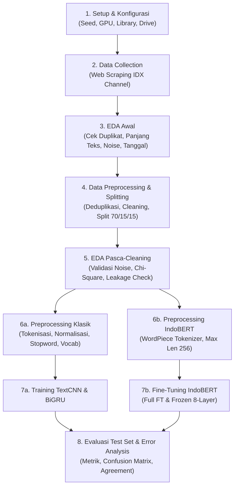

# Klasifikasi Berita IDX Channel (Pemrosesan Bahasa Alami - Tugas 2)

Repositori ini berisi implementasi pipeline *end-to-end* klasifikasi teks berita bahasa Indonesia dari portal **IDX Channel** ke dalam 4 kategori (**Banking**, **Economics**, **Market News**, dan **Technology**) pada notebook [`[Klasifikasi_Berita]_[Tugas_2]_Pemrosesan_Bahasa_Alami (2).ipynb`](./%5BKlasifikasi_Berita%5D_%5BTugas_2%5D_Pemrosesan_Bahasa_Alami%20(2).ipynb).

Pipeline ini membandingkan empat skenario model deep learning dan *pre-trained language model*: **TextCNN**, **BiGRU**, **IndoBERT (Full Fine-Tuning)**, dan **IndoBERT (Frozen 8-Layer)**.

---

## Ringkasan Alur Pipeline

---

## Penjelasan Detail Setiap Tahap Pipeline

### 1. Setup & Konfigurasi Lingkungan
* Menginstal library `Sastrawi` dan mengimpor pustaka pendukung (`torch`, `transformers`, `scikit-learn`, `scipy`, `pandas`, `BeautifulSoup`, `matplotlib`, `seaborn`).
* Menetapkan `SEED = 42` pada `random`, `numpy`, dan `torch` untuk menjaga reprodusibilitas eksperimen.
* Mendeteksi perangkat komputasi (`cuda` / `cpu`) dan melakukan *mount* Google Drive untuk penyimpanan/pembacaan dataset.

### 2. Data Collection (Web Scraping)
Pengambilan data dilakukan secara langsung dari indeks harian dan endpoint AJAX situs `idxchannel.com`:
* **Kanal & Target Kuota**: 4 kategori resmi dengan target **1.100 artikel per kelas** (total target 4.400 artikel), menelusuri indeks harian mundur maksimal 600 hari:
  * `Banking` (`idkanal=9773`, `/banking/`)
  * `Economics` (`idkanal=9772`, `/economics/`)
  * `Market News` (`idkanal=1`, `/market-news/`)
  * `Technology` (`idkanal=89397`, `/technology/`)
* **Ekstraksi Artikel**: Mengambil judul (`<h1>`) dan seluruh paragraf (`
`) dari seluruh halaman paginasi artikel (`scrape_full_raw_article`).
* **Validasi & Penyimpanan**: Artikel dengan minimal 15 kata digabungkan (`title + raw_content`) ke kolom `raw_text`, dideduplikasi berdasarkan `raw_text`, lalu disimpan ke `dataset_idxchannel_raw_1100.csv`.

### 3. Exploratory Data Analysis (EDA) Awal
Dataset yang dimuat (`dataset_idxchannel.csv`) berjumlah **4.388 artikel** dengan kolom `url`, `title`, `raw_text`, dan `category`. Pemeriksaan yang dilakukan meliputi:
* **Integritas Data**: Tidak ada *missing value* maupun string kosong; ditemukan **1 judul duplikat / near-duplicate** (berdasarkan 200 karakter awal yang dinormalisasi).
* **Distribusi Kelas**: Seimbang di keempat kategori (`Banking`: 1.099, `Economics`: 1.098, `Market News`: 1.097, `Technology`: 1.094).
* **Panjang Teks**: Rata-rata panjang artikel 381,67 kata (maksimal 5.899 kata, 176 outlier IQR).
* **Analisis Noise Templat Situs**: Mengidentifikasi pola berulang non-berita seperti `"Scan this QR"` (100%), `"IDXChannel"` (99,77%), *byline* penulis di akhir artikel (96,42%), footer `"Halaman :"` (6,84%), `"Baca Juga"` (2,42%), URL (0,27%), serta karakter non-ASCII (`\xa0`, `\u200e`, tanda kutip lengkung).
* **Potensi Shortcut & Distribusi Temporal**: Memeriksa dominasi ticker saham per kategori (mis. `IHSG` 98,9% di Market News, `BBTN` 97,5% di Banking) serta mengekstrak tanggal publikasi dari teks (terdeteksi pada 86,1% artikel).
* **Frekuensi Kata Mentah**: Sebelum dibersihkan, 20 kata terbanyak masih didominasi stopword dan kata templat (`qr`, `app`, `download`, `scan`, `this`).

### 4. Data Preprocessing & Splitting
1. **Penghapusan Duplikat Awal**: Menghapus duplikat berdasarkan `raw_text` dan `title` (1 artikel dibuang, tersisa **4.387 artikel**).
2. **Pembersihan Teks (`bersihkan()`)**:
   * Menghapus karakter tak terlihat (`\xa0`, karakter *zero-width*) dan URL.
   * Menghapus pengulangan `title` di awal `raw_text`.
   * Menghapus elemen templat: footer `"Halaman :"`, `"Baca Juga"`, `"Disclaimer"`, tag `Reporter:`/`Editor:`, *byline* penulis di akhir kalimat, kalimat `"Scan this QR or download app from..."` beserta *dateline*.
   * Menyamarkan pola tanggal (`dd/mm/yyyy`) dan tahun (`19xx`/`20xx`) jika `mask_tanggal=True`, serta merapikan tanda baca dan spasi ganda menjadi kolom `teks_bersih`.
3. **Pemeriksaan Pasca-Cleaning**:
   * Memastikan tidak ada teks identik dengan kategori berbeda (0 kasus), tidak ada duplikat baru pada `teks_bersih` (0 kasus), dan tidak ada artikel `< 20` kata (0 dibuang). Total akhir tetap **4.387 artikel**.
4. **Label Encoding & Stratified Splitting**:
   * Pemetaan kelas: `{'Banking': 0, 'Economics': 1, 'Market News': 2, 'Technology': 3}`.
   * Data dibagi secara *stratified* (`random_state=42`) menjadi **70% Train (3.070)**, **15% Validation (658)**, dan **15% Test (659)** sebelum pembangunan vocabulary agar tidak terjadi *data leakage*.

### 5. Exploratory Data Analysis (EDA) Setelah Cleaning
* **Dampak Cleaning**: Rata-rata panjang kata berkurang **14,15%** (381,6 → 327,6 kata; reduksi terbesar pada `Technology` sebesar 23,14%). Seluruh pola noise utama turun menjadi **0,00%** (kecuali `IDXChannel` dari 99,82% menjadi 1,46%).
* **Analisis Fitur pada Data Train**:
  * Menampilkan Top-10 kata tersering per kategori (tanpa stopword).
  * Mengekstrak Top-15 unigram/bigram paling diskriminatif per kelas menggunakan **Chi-Square (`chi2`)**.
  * Memeriksa potensi kebocoran kemunculan nama kategori secara eksplisit di dalam teks.

### 6. Per-Model Preprocessing
Pada tahap ini, judul dan isi bersih digabungkan (`teks_input = title + ". " + teks_bersih`) agar sinyal topik dari judul ikut dipelajari.

* **Pipeline A — TextCNN & BiGRU (`tokenisasi_klasik`)**:
  * *Case folding*, normalisasi nominal Rupiah (`<uang>`) dan persentase (`<persen>`), penghapusan karakter non-alfabet, pemfilteran token panjang > 1 karakter, dan *stopword removal* menggunakan daftar **Sastrawi** (tanpa *stemming*).
  * Vocabulary dibangun **hanya dari data train** (`MAX_VOCAB = 20.000`, `MIN_FREQ = 2`), menghasilkan **17.056 token** (termasuk `<PAD>` dan `<UNK>`).
  * Sekuens di-*pad*/potong menjadi panjang tetap `MAX_LEN_SEQ = 300` dengan `BATCH_SIZE_SEQ = 64` (beserta pengecekan Top-8 kata kunci TF-IDF per kategori).

* **Pipeline B — IndoBERT (`IndoBERTNewsDataset`)**:
  * Menggunakan tokenizer **WordPiece** dari `indobenchmark/indobert-base-p1` tanpa *stopword removal*, *stemming*, maupun normalisasi angka agar struktur sintaksis alami tetap terjaga.
  * Dari analisis panjang token pada `teks_bersih` train, 28,11% artikel melebihi 512 token. Untuk efisiensi GPU saat training, digunakan `MAX_LEN_BERT = 256`, `padding="max_length"`, `truncation=True`, dan `BATCH_SIZE_BERT = 16`.

### 7. Model Training
Seluruh model dilatih menggunakan fungsi loss `CrossEntropyLoss`, optimizer `AdamW`, *gradient clipping* (`max_norm=1.0`), serta *early stopping* berdasarkan **Validation Macro-F1** (bobot terbaik disimpan otomatis):

| Model | Arsitektur & Konfigurasi Utama | Hyperparameter Training | Waktu Latih | Best Val Macro-F1 |
| :--- | :--- | :--- | :---: | :---: |
| **TextCNN** | Embedding (128) + 3 Conv1D (`kernel_size=(3,4,5)`, 128 filter) + Global MaxPool + Dropout (0.4) + Linear | `epochs=12`, `lr=1e-3`, `weight_decay=1e-3`, `patience=3` (stop di epoch 11) | 9,1s | 0,9049 |
| **BiGRU** | Embedding (128) + 2-layer Bidirectional GRU (`hidden_dim=128`, `dropout=0.4`) + Global Avg & MaxPool + Linear | `epochs=12`, `lr=1e-3`, `weight_decay=1e-3`, `patience=4` (12 epoch penuh) | 20,7s | 0,8937 |
| **IndoBERT (Full FT)** | `indobenchmark/indobert-base-p1` dengan seluruh parameter dilatih | `epochs=4`, `lr=2e-5`, `weight_decay=0.01`, linear warmup 10%, `patience=2` (stop di epoch 3) | 508,8s | 0,9120 |
| **IndoBERT (Frozen 8-Layer)** | Membekukan layer Embedding & Encoder Layer 0–7; melatih Layer 8–11, Pooler, dan Classifier (`23,26%` parameter / 28,95M dari 124,44M) | `epochs=4`, `lr=5e-5`, `weight_decay=0.01`, linear warmup 10%, `patience=2` (4 epoch penuh) | 391,0s | 0,9147 |

### 8. Evaluasi Model & Error Analysis
Evaluasi dilakukan sekali pada **Test Set (659 artikel)**:

| Model | Accuracy (%) | Precision Macro (%) | Recall Macro (%) | F1 Macro (%) |
| :--- | :---: | :---: | :---: | :---: |
| **TextCNN** | 89,38 | 89,59 | 89,39 | 89,34 |
| **BiGRU** | 88,32 | 88,31 | 88,33 | 88,22 |
| **IndoBERT (Full FT)** | 90,59 | 90,60 | 90,60 | 90,57 |
| **IndoBERT (Frozen)** | **91,20** | **91,16** | **91,21** | **91,12** |

Analisis lanjutan yang dilakukan pada tahap evaluasi:
* **Visualisasi**: *Classification report* per kelas, grid *learning curves* (Train Loss, Val Loss, Val Macro-F1), dan *confusion matrix* untuk keempat model.
* **Pairwise Model Agreement & Perbandingan Model (Poin 10)**: Mengukur kesepakatan prediksi antar model di test set (misalnya `TextCNN` vs `IndoBERT (Full FT)` **91,35%**, `IndoBERT (Full FT)` vs `IndoBERT (Frozen)` **83,92%**), serta menjelaskan mengapa `IndoBERT (Frozen 8-Layer)` mengungguli `IndoBERT (Full FT)`, `TextCNN`, dan `BiGRU`.
* **Error Analysis Model Terbaik (Poin 11)**: Memilih model terbaik secara otomatis berdasarkan Test Macro-F1 (`IndoBERT (Frozen)` — **91,12%**), lalu merekapitulasi pasangan kelas yang paling sering tertukar dan menampilkan 8 artikel salah klasifikasi dengan tingkat *confidence* tertinggi untuk analisis kualitatif.

